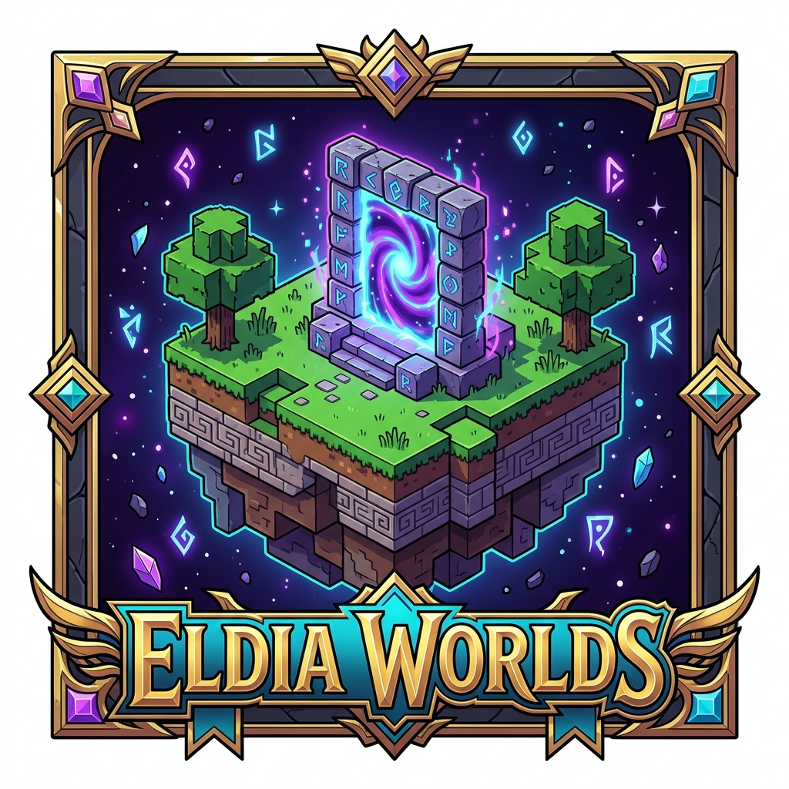

# Eldia Worlds

  

Create and manage **real Custom Dimensions (`type=999`)** and isolated worlds inside a single [Endstone](https://github.com/EndstoneMC/endstone) Bedrock Dedicated Server — no extra ports or proxies required.

## Features

- **True Custom Dimensions (`type=999`)**: Creates real separate dimensions (`Void`, `Flat`, or `Normal` generators) with their own origin at `(0.5, 64.0, 0.5)` via `eldia_worlds_native`.
- **Persistent Across Restarts**: Automatically re-registers all custom dimensions on server startup so builds and terrain are preserved.
- **Interactive Bedrock UI**: Run `/world` to browse, teleport to, or create new worlds from an in-game form menu.
- **World Borders & GameModes**: Enforce per-world border radii and automatically switch player `GameMode` on teleport.
- **Safe Spawn Platforms**: Automatically builds a starter spawn platform for `void` and `flat` worlds.

## Installation

1. Download the release files from [GitHub Releases](https://github.com/Karanztez/eldia-worlds/releases):
   - **Linux:** `endstone_eldia_worlds-0.2.0-py3-none-any.whl` + `endstone_eldia_worlds_native.so`
   - **Windows:** `endstone_eldia_worlds-0.2.0-py3-none-any.whl` + `endstone_eldia_worlds_native.dll`
2. Place them into `bedrock_server/plugins/`.
3. Restart your Endstone server.

## Commands

### World Manager (`/world`, `/dim`, `/worlds`)

| Command | Description | Permission |
| --- | --- | --- |
| `/world` | Open the World Manager UI | `eldia_worlds.command.world` |
| `/world list` | List all registered worlds | `eldia_worlds.command.world` |
| `/world info <name>` | View world details and spawn coordinates | `eldia_worlds.command.world` |
| `/world tp <name> [player]` | Teleport to a world | `eldia_worlds.command.tp` |
| `/world create <name> [void\|flat\|normal] [dimension] [radius]` | Create a new dimension and teleport there | `eldia_worlds.command.admin` |
| `/world load <name> [radius]` | Pre-load and build chunks around spawn before teleporting | `eldia_worlds.command.admin` |
| `/world import` | Auto-import Bedrock maps placed in `plugins/eldia_worlds/import/` into `overworld` | `eldia_worlds.command.admin` |
| `/world setspawn [name]` | Set a world's spawn to your position | `eldia_worlds.command.admin` |
| `/world setborder <name> <radius>` | Set border radius (`0` = unlimited) | `eldia_worlds.command.admin` |
| `/world setgamemode <name> <mode\|none>` | Set per-world GameMode | `eldia_worlds.command.admin` |
| `/world delete <name>` | Remove a custom world from the list | `eldia_worlds.command.admin` |

### Native Dimension Diagnostics (`/nativeworld`)

| Command | Description | Permission |
| --- | --- | --- |
| `/nativeworld status` | Show loaded server module status | `eldia_worlds_native.command.nativeworld` |
| `/nativeworld scan` | Verify native `DimensionManager` signatures | `eldia_worlds_native.command.nativeworld` |
| `/nativeworld list` | List all loaded dimensions (`0`, `1`, `2`, `999`) | `eldia_worlds_native.command.nativeworld` |
| `/nativeworld create <name> [void\|flat\|normal]` | Directly create a native custom dimension | `eldia_worlds_native.command.nativeworld` |

## Documentation

- [Architecture & Internals](./docs/architecture.md)
- [Building & Signature Scanning](./docs/building.md)
- [Native Plugin Notes](./native/README.md)
